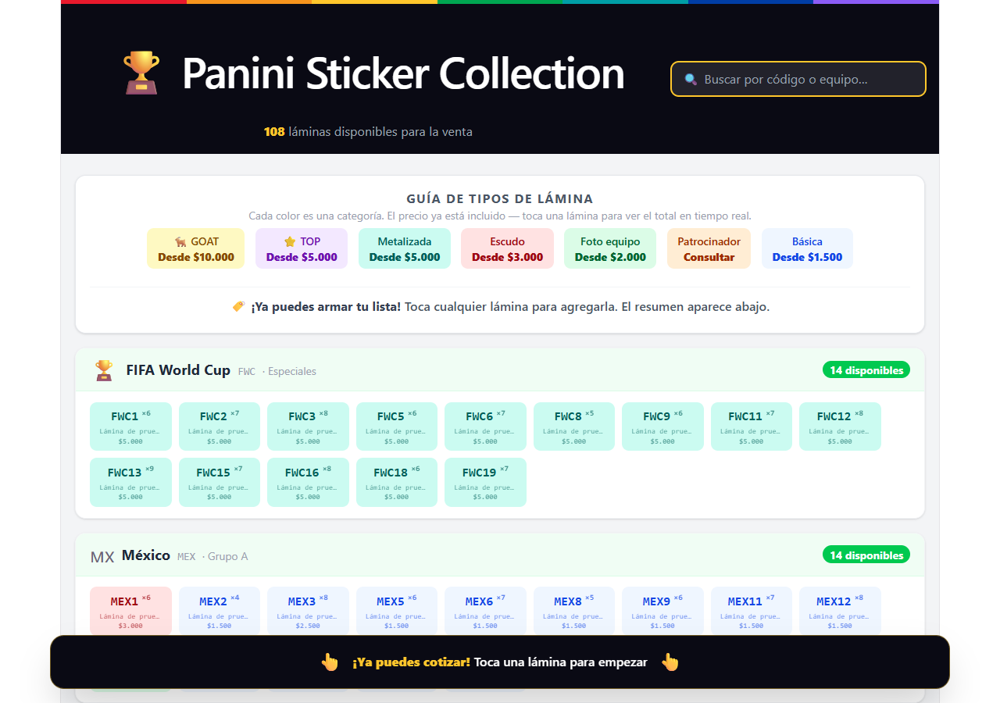

# Panini Sticker Collection

Edición preparada para el portafolio a partir del proyecto original. Los vendedores, nombres de láminas y precios iniciales son de demostración. El historial de desarrollo se conserva en el repositorio original.

Aplicación web para gestionar existencias de láminas del álbum del Mundial FIFA 2026. Los vendedores actualizan cantidades, estados y precios desde un panel. Los visitantes consultan el stock disponible y preparan una lista para coordinar la compra.

## Qué permite hacer

- Consultar el catálogo general o el de un vendedor y buscar por código de lámina, código de equipo o nombre de equipo.
- Seleccionar varias copias de una lámina hasta el límite del stock y copiar la lista. Con un contacto configurado, las cotizaciones con precio también pueden abrir WhatsApp con el mensaje preparado.
- Administrar el inventario asignado desde una matriz por equipos o una vista de edición detallada. El panel recibe cambios de inventario mediante Supabase Realtime.
- Editar cantidades, observaciones, categorías y precios, consultar métricas y exportar la matriz, el listado por categoría y el resumen por equipo a Excel.

| Ruta | Vista |
| --- | --- |
| `/` | Catálogo general |
| `/laminas/:slug` | Catálogo por vendedor, por ejemplo `/laminas/demo-cn` y `/laminas/replica` |
| `/admin/login` | Inicio de sesión |
| `/admin` | Matriz de inventario |
| `/admin/crud` | Edición detallada |
| `/admin/dashboard` | Métricas y exportación a Excel |

## Tecnologías

- **Interfaz** con React, TypeScript, Vite, Tailwind CSS y React Router.
- **Datos y estado** con TanStack Query para consultas, Zustand para el inventario de la vista activa y TanStack Virtual en la edición detallada.
- **Backend** con PostgreSQL, Auth, Row Level Security (RLS) y Realtime en Supabase.
- **Exportación y verificación** con `xlsx-js-style`, Vitest, jsdom, ESLint y GitHub Actions.

## Estructura

```text
src/
  components/     Catálogo público, panel y componentes compartidos
  hooks/          Sesión, inventario, precios y cotizaciones
  services/       Consultas y escrituras en Supabase
  store/          Inventario en memoria de la vista activa
  lib/            Reglas del álbum, precios y exportación
  types/          Tipos del dominio
supabase/         Migraciones, datos iniciales y comprobaciones SQL
tests/            Pruebas automatizadas y utilidades de prueba
.github/workflows/ Verificación automática del repositorio
```

## Puesta en marcha

Usa **Node.js 24 y npm**, la versión de Node configurada en CI. Para recorrer el catálogo y el panel necesitas un proyecto Supabase de pruebas. Si eliges Supabase local, instala también su CLI y un motor compatible con Docker.

1. Instala las dependencias con `npm ci`.
2. Copia [`.env.example`](.env.example) como `.env`. En PowerShell puedes usar `Copy-Item .env.example .env`.
3. Sigue la [guía de Supabase](supabase/README.md) para aplicar las migraciones, ejecutar el seed y asignar cuentas de prueba a un inventario. El seed crea 994 láminas por inventario en estado faltante. Marca algunas como disponibles con stock positivo para probar el catálogo.
4. Completa las variables de entorno y ejecuta `npm run dev`. Abre la dirección local que imprima Vite.

| Variable | Valor esperado |
| --- | --- |
| `VITE_SUPABASE_URL` | URL del proyecto de pruebas. |
| `VITE_SUPABASE_ANON_KEY` | Clave publicable del proyecto o clave `anon` heredada. |
| `VITE_WHATSAPP_NUMBER` | Opcional. Contacto público en formato internacional, con código de país y solo dígitos. Si queda vacía, la opción de copiar sigue disponible. |

Las variables `VITE_*` se incluyen en el código que recibe el navegador. Mantén las claves secretas y de servicio fuera de estas variables. Para una demo pública, deja el número de WhatsApp vacío. [Variables de entorno de Vite](https://vite.dev/guide/env-and-mode) · [Claves de Supabase](https://supabase.com/docs/guides/getting-started/api-keys)

| Comando | Uso |
| --- | --- |
| `npm run dev` | Inicia el servidor de desarrollo. |
| `npm test` | Ejecuta la suite de Vitest con servicios simulados. |
| `npm run lint` | Revisa el código con ESLint. |
| `npm run build` | Comprueba los tipos y construye la aplicación en `dist/`. |
| `npm run preview` | Sirve localmente la compilación para revisarla. |

## Inventarios y permisos

Una lámina se identifica por su código y su inventario, `CN` o `AM`. Así, el mismo código puede tener cantidades y precios distintos en cada grupo. Cada vendedor inicia sesión con Supabase Auth. PostgreSQL usa su UUID y su membresía para limitar las consultas privadas y las ediciones al inventario asignado.

El catálogo público obtiene solo las columnas que necesita y las láminas disponibles con stock positivo. Los visitantes pueden consultar esa información sin sesión. Los precios base por categoría son compartidos y editables por vendedores con membresía. Cuando una lámina tiene precio individual, ese valor prevalece. El catálogo público de `AM` muestra la lista sin precios.

## Demostración

Las capturas se tomaron en Chrome con la aplicación conectada a Supabase local. Las cuentas, existencias, precios y observaciones son datos de prueba.



1. [Cotización](docs/screenshots/02-cotizacion.png) con varias láminas seleccionadas y el total visible.
2. [Matriz de inventario](docs/screenshots/03-matriz.png) con cantidades y estados agrupados por equipo.
3. [Edición detallada](docs/screenshots/04-edicion.png) con stock y observaciones de ejemplo.
4. [Dashboard](docs/screenshots/05-dashboard.png) con métricas y la opción de exportar a Excel.

## Límites y verificaciones

- Las cotizaciones preparan listas para compartir y la compra se coordina por fuera de la aplicación.
- La suite de frontend simula Supabase. El proyecto original se verificó con Auth, Data API y Realtime en Supabase local. También se probaron los flujos en Chrome de escritorio y con un ancho móvil emulado.
- GitHub Actions ejecuta la instalación de dependencias, ESLint, las 20 pruebas automatizadas y la compilación. Las comprobaciones se superaron en Linux con Node.js 24. [Ver ejecuciones de CI](https://github.com/mandresjacome/panini-sticker-collection-portfolio/actions).

## Autor

Mario Andrés Jácome Mantilla · [@mandresjacome](https://github.com/mandresjacome)

El proyecto original fue desarrollado por el mismo autor bajo el nombre AmalfiDev.

## Créditos

Los nombres del catálogo original se atribuyen a PaniniTrade. La estructura del álbum proviene de la planilla de control indicada en el [seed](supabase/seed.sql). [Migración del catálogo](supabase/migrations/004_add_sticker_names.sql).
